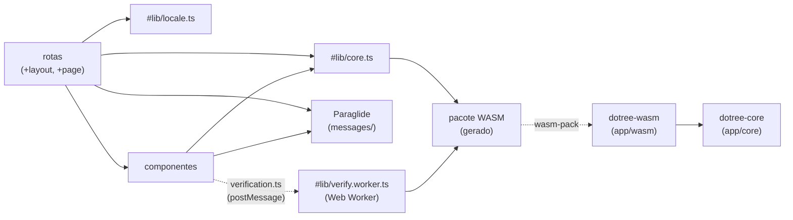

<!-- Caminho relativo: docs/architecture.md -->

# Arquitetura efetiva

> Derivada das dependências reais entre módulos (skill `mapa-de-arquitetura`). Atualizada no
> mesmo trabalho que mudar módulos ou dependências. Estado: esqueleto + `expr` (MT-3) + `matrix` (MT-4) + `reduce` (MT-5, MT-6) + `netlist` e `verify` (MT-7) + `diagram` (MT-9) + `vhdl` (MT-10) + `help` (MT-8) + interface da matriz (MT-11a) + visão indexada e desafio de $W$ (MT-11b) + compressão na interface (MT-12a) + CPA, resultado e caminho crítico na interface (MT-12b) + ajuda sob demanda (MT-13) + diagrama e tabela na interface (MT-14a) + verificação e VHDL na interface (MT-14b).

## Componentes

| Componente | Onde | Responsabilidade | Depende de |
|---|---|---|---|
| `dotree-core` | `app/core` | Domínio puro. Expõe `version()` e os módulos `expr`, `matrix`, `reduce`, `help`, `netlist`, `verify`, `diagram`, `vhdl`, `board` e `state`. | `serde`, `serde_json` |
| `dotree_core::expr` | `app/core/src/expr/` | Linguagem da expressão: lexer e analisador recursivo (`parser.rs`) que expande enquanto lê; `analyze()` valida larguras e limite de bits. Erros como códigos (IDI-05). | — |
| `dotree_core::matrix` | `app/core/src/matrix/` | Matriz de pontos do nível 0: cópias por bit do coeficiente, sinais compartilhados, ANDs, pontos fixos da constante (`one`), $v_{max}$, $W$, ordem canônica. | `expr` |
| `dotree_core::reduce` | `app/core/src/reduce/` | Compressão nível a nível: células FA/HA, prontidão em meios $T_{FA}$, numeração, recusas, CPA *ripple*, resultado, métricas, caminho crítico; histórico de desfazer/refazer por cópia de estado com registro de todos os pontos por id. | `matrix` |
| `dotree_core::help` | `app/core/src/help/` | Método de Dadda: próxima jogada a partir do estado do aluno, solução automática (seguir a próxima jogada), dicas por código, limite inferior. | `reduce`, `matrix` |
| `dotree_core::netlist` | `app/core/src/netlist/` | Circuito completo como fios (`Wire`) e células em ordem de número; identificadores comuns a diagrama, tabela e VHDL; empacotamento das entradas. | `matrix`, `reduce` |
| `dotree_core::diagram` | `app/core/src/diagram/` | Leiaute em grade do diagrama de blocos, ligações rotuladas, células críticas recalculadas da netlist, tabela de ligações e Markdown (cabeçalhos vindos da interface). | `netlist` |
| `dotree_core::board` | `app/core/src/board/` | Placa DE2 (spec 10): limites (18 bits de entrada, $W \le 32$), pinos de `SW`, `LEDR` e `HEX0`–`HEX7` e segmentos dos dígitos hexadecimais. | `netlist` |
| `dotree_core::vhdl` | `app/core/src/vhdl/` | Gera VHDL-93 ASCII: `full_adder`, `half_adder`, topo estrutural, versão comportamental com as mesmas portas (`numeric_std`) e testbench que confere as duas (exaustivo ou amostra); com o circuito na placa, topo `<nome>_de2`, testbench da placa e projeto do Quartus (`.qpf`/`.qsf`); comentários e mensagens em pt-BR/en; validação do nome da entidade. Exemplo `vhdl_referencia` + `ghdl_casos.sh` alimentam o job de CI. | `netlist`, `matrix`, `verify` |
| `dotree_core::state` | `app/core/src/state/` | Arquivo do exercício (spec 08): `Exercise::capture` → JSON com `format` e `schema`; `parse` confere marca e esquema antes dos campos; `restore` refaz a matriz e cada célula pelas regras de `reduce` (entradas por posição na ordem canônica do nível). Recusas como `StateError`. | `expr`, `matrix`, `reduce`, `help` |
| `dotree_core::verify` | `app/core/src/verify/` | Simulação bit-paralela (64 vetores por `u64`), exaustiva até 24 bits ou por amostra xorshift64\*, em blocos (progresso e cancelamento), contraexemplo. | `netlist` |
| `dotree-wasm` | `app/wasm` | Ponte `wasm-bindgen`: `coreVersion()`, `buildMatrix(src, widthsJson)` e a classe `Session` (estado da compressão no núcleo: `snapshot`, `formCell`, `concludeLevel`, `closeWithCpa`, `goToLevel`, `undo`, `redo`; ajuda que conta cada revelação: `hint`, `nextMove`, `lowerBound`, `solution` (outra `Session`, com a solução de Dadda), `applySolution` (troca o circuito pela solução num passo de desfazer, `Reduction::adopt`), `helpLog`; diagrama e tabela dos níveis concluídos: `diagram`, `wiringTable`, `wiringTableMarkdown`; circuito completo: `netlist` (JSON de `netcodec.rs`, conferido ao voltar) e `vhdl`; arquivo do exercício: `exercise`, `restore` (recusa com código), `expression`, `widths`, `revealWidth`, `revealWidthPath`, `revealed`, `shownLowerBound` e `shownSolution` (o já revelado, sem contar de novo); e a classe `Verification`, que verifica em blocos dentro do *worker*; o snapshot traz o motivo do bloqueio do CPA, o resultado e as células críticas), tudo em JSON com códigos (contratos em `app/wasm/tests/bridge.rs`, `session.rs`, `diagram.rs`, `verification.rs` e `exercise.rs`). | `dotree-core`, `wasm-bindgen`, `serde_json` |
| Pacote WASM gerado | `app/web/src/lib/wasm/` (fora do git) | Saída do `wasm-pack` (`dotree.js`, `dotree_bg.wasm`). | `dotree-wasm` |
| `#lib/core.ts` | `app/web/src/lib/core.ts` | Carrega o WASM e tipa o JSON da ponte (`Matrix`, `CoreError`, `Snapshot`, `Rejection`); `openSession` embrulha a `Session`. | pacote WASM |
| `#lib/errors.ts` | `app/web/src/lib/errors.ts` | Traduz códigos de erro, aviso, recusa, bloqueio do CPA e recusa de arquivo do núcleo (IDI-05). | Paraglide, `core.ts` (tipos) |
| `#lib/expression.ts` | `app/web/src/lib/expression.ts` | Variáveis do texto (um campo de largura cada) e exemplos embutidos. | — |
| `#lib/signal.ts` | `app/web/src/lib/signal.ts` | Separa o identificador do sinal em letra e índice para a visão indexada. | — |
| `#lib/view.ts` | `app/web/src/lib/view.ts` | Visão pontos/indexada: preferência guardada. | — |
| `#lib/keys.ts` | `app/web/src/lib/keys.ts` | Atalhos de teclado (V, F, Esc, Ctrl+Z, Ctrl+Y), nunca dentro de campo de texto. | — |
| `#lib/help.ts` | `app/web/src/lib/help.ts` | Texto das dicas, da próxima jogada e do registro de ajudas (spec 03). | Paraglide, `core.ts` (tipos) |
| `#lib/diagram.ts` | `app/web/src/lib/diagram.ts` | Geometria e SVG do diagrama de blocos a partir da grade do núcleo; o mesmo texto serve a tela e o arquivo exportado. | `core.ts` (tipos) |
| `#lib/persist.ts` | `app/web/src/lib/persist.ts` | Exercício no armazenamento local: ler, gravar e apagar sem lançar erro, e `autosaving`, que embrulha a sessão e grava o arquivo do exercício depois de cada ação ou revelação (SAL-01, SAL-04). | `core.ts` (tipos) |
| `#lib/download.ts` | `app/web/src/lib/download.ts` | Salva texto ou bytes gerados como arquivo, sem servidor. | — |
| `#lib/verify.worker.ts` | `app/web/src/lib/verify.worker.ts` | *Worker* da verificação, um só por visita: carrega o próprio pacote WASM ao nascer e avisa `ready`; roda `Verification` em blocos por número de execução, cedendo a vez entre blocos para receber o cancelamento. | pacote WASM |
| `#lib/verification.ts` | `app/web/src/lib/verification.ts` | `Verifier`: cria o *worker* no carregamento da página (`prewarmVerification`, esperado junto com o núcleo para que nada seja buscado depois, GER-05), numera as execuções, repassa o progresso, cancela por mensagem e recria o *worker* se ele morrer. | `verify.worker.ts` (tipos), `core.ts` (tipos) |
| `#lib/zip.ts` | `app/web/src/lib/zip.ts` | `.zip` sem compressão (CRC-32, cabeçalhos, diretório central) para os arquivos VHDL. | — |
| `#lib/levels.ts` | `app/web/src/lib/levels.ts` | Arrumação das colunas de um painel (células, depois pontos soltos), coluna mais alta visível e formato de meias unidades. | `core.ts` (tipos) |
| `#lib/width.ts` | `app/web/src/lib/width.ts` | Arruma a conta da etapa 2 do desafio de $W$ com os valores do núcleo. | `core.ts` (tipos) |
| `#lib/locale.ts` | `app/web/src/lib/locale.ts` | Idioma da primeira visita (IDI-03). | — |
| Catálogos i18n | `app/web/messages/`, gerados em `src/lib/paraglide/` | Textos pt-br e en (Paraglide). | — |
| Rotas | `app/web/src/routes/` | Layout (idioma, tokens CSS) e página inicial: formulário → `buildMatrix` + `openSession` (confirmando antes de descartar uma compressão, EXP-04), ou exportar e abrir o exercício como JSON (`restoreSession`, recusa explicada sem mexer no exercício aberto); salvamento automático e oferta de retomada, aviso de armazenamento indisponível e estado salvo corrompido com download → legenda, desafio de $W$ e compressão, ou erro; estado da visão e atalho V. | `#lib/core.ts`, `#lib/errors.ts`, `#lib/locale.ts`, Paraglide, componentes |
| Componentes | `app/web/src/lib/components/` | `LanguageSwitch`, `ExpressionForm`, `TermLegend`, `ViewToggle`, `WidthChallenge`, `ConfirmDialog` (reutilizado por toda ajuda), `LevelPanel` (um nível, só leitura, selecionável ou resultado), `Rules`, `Coach` (dica e próxima jogada), `SolutionHelp` (limite inferior e solução em duas etapas; usar a solução depois da etapa 2), `CircuitView` (diagrama, tabela de ligações, exportações), `VerifyView` (verificação, progresso, cancelamento, contraexemplo), `VhdlView` (nome, cópia, `.zip`), `Compression` (painéis, ações, CPA, resultado, caminho crítico, volta de nível, métricas, teclado; modo leitura abaixo de 768 px, GER-10). | Paraglide, `expression.ts`, `signal.ts`, `view.ts`, `keys.ts`, `levels.ts`, `width.ts`, `errors.ts`, `core.ts`, `diagram.ts`, `download.ts`, `verification.ts`, `zip.ts` |

## Dependências

## Fronteiras que a arquitetura protege

- O núcleo não conhece navegador nem WASM (ADR 0001): `app/core/Cargo.toml` só depende de
  `serde` e `serde_json` (Rust puro), para o arquivo do exercício.
- A interface não tem regra de domínio: só chama `#lib/core.ts` (ou, na verificação, o
  mesmo pacote WASM dentro do *worker*).
- Entrega: a mesma build estática vai para o GitHub Pages (`/dotree/`) e para a imagem
  Docker (raiz) — ADR 0002.
