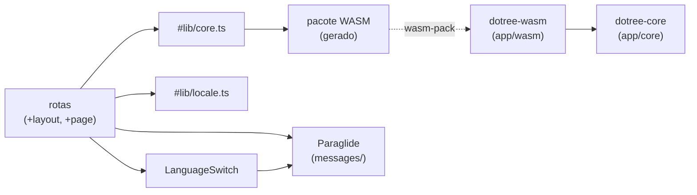

<!-- Caminho relativo: docs/architecture.md -->

# Arquitetura efetiva

> Derivada das dependências reais entre módulos (skill `mapa-de-arquitetura`). Atualizada no
> mesmo trabalho que mudar módulos ou dependências. Estado: esqueleto + `expr` (MT-3) + `matrix` (MT-4) + `reduce` (MT-5, MT-6) + `netlist` e `verify` (MT-7) + `diagram` (MT-9) + `vhdl` (MT-10) + `help` (MT-8) + interface da matriz (MT-11a).

## Componentes

| Componente | Onde | Responsabilidade | Depende de |
|---|---|---|---|
| `dotree-core` | `app/core` | Domínio puro. Expõe `version()` e os módulos `expr`, `matrix`, `reduce`, `help`, `netlist`, `verify`, `diagram` e `vhdl`. | — |
| `dotree_core::expr` | `app/core/src/expr/` | Linguagem da expressão: lexer e analisador recursivo (`parser.rs`) que expande enquanto lê; `analyze()` valida larguras e limite de bits. Erros como códigos (IDI-05). | — |
| `dotree_core::matrix` | `app/core/src/matrix/` | Matriz de pontos do nível 0: cópias por bit do coeficiente, sinais compartilhados, ANDs, $v_{max}$, $W$, ordem canônica. | `expr` |
| `dotree_core::reduce` | `app/core/src/reduce/` | Compressão nível a nível: células FA/HA, prontidão em meios $T_{FA}$, numeração, recusas, CPA *ripple*, resultado, métricas, caminho crítico; histórico de desfazer/refazer por cópia de estado com registro de todos os pontos por id. | `matrix` |
| `dotree_core::help` | `app/core/src/help/` | Método de Dadda: próxima jogada a partir do estado do aluno, solução automática (seguir a próxima jogada), dicas por código, limite inferior. | `reduce`, `matrix` |
| `dotree_core::netlist` | `app/core/src/netlist/` | Circuito completo como fios (`Wire`) e células em ordem de número; identificadores comuns a diagrama, tabela e VHDL; empacotamento das entradas. | `matrix`, `reduce` |
| `dotree_core::diagram` | `app/core/src/diagram/` | Leiaute em grade do diagrama de blocos, ligações rotuladas, células críticas recalculadas da netlist, tabela de ligações e Markdown (cabeçalhos vindos da interface). | `netlist` |
| `dotree_core::vhdl` | `app/core/src/vhdl/` | Gera VHDL-93 ASCII: `full_adder`, `half_adder`, topo estrutural e testbench (exaustivo ou amostra); comentários e mensagens em pt-BR/en; validação do nome da entidade. Exemplo `vhdl_referencia` + `ghdl_casos.sh` alimentam o job de CI. | `netlist`, `matrix`, `verify` |
| `dotree_core::verify` | `app/core/src/verify/` | Simulação bit-paralela (64 vetores por `u64`), exaustiva até 24 bits ou por amostra xorshift64\*, em blocos (progresso e cancelamento), contraexemplo. | `netlist` |
| `dotree-wasm` | `app/wasm` | Ponte `wasm-bindgen`: `coreVersion()` e `buildMatrix(src, widthsJson)`, que devolve JSON com a matriz ou um erro por código (contrato em `app/wasm/tests/bridge.rs`). | `dotree-core`, `wasm-bindgen`, `serde_json` |
| Pacote WASM gerado | `app/web/src/lib/wasm/` (fora do git) | Saída do `wasm-pack` (`dotree.js`, `dotree_bg.wasm`). | `dotree-wasm` |
| `#lib/core.ts` | `app/web/src/lib/core.ts` | Carrega o WASM e tipa o JSON da ponte (`Matrix`, `CoreError`). | pacote WASM |
| `#lib/errors.ts` | `app/web/src/lib/errors.ts` | Traduz códigos de erro e aviso do núcleo (IDI-05). | Paraglide, `core.ts` (tipos) |
| `#lib/expression.ts` | `app/web/src/lib/expression.ts` | Variáveis do texto (um campo de largura cada) e exemplos embutidos. | — |
| `#lib/locale.ts` | `app/web/src/lib/locale.ts` | Idioma da primeira visita (IDI-03). | — |
| Catálogos i18n | `app/web/messages/`, gerados em `src/lib/paraglide/` | Textos pt-br e en (Paraglide). | — |
| Rotas | `app/web/src/routes/` | Layout (idioma, tokens CSS) e página inicial: formulário → `buildMatrix` → matriz e legenda, ou erro. | `#lib/core.ts`, `#lib/errors.ts`, `#lib/locale.ts`, Paraglide, componentes |
| Componentes | `app/web/src/lib/components/` | `LanguageSwitch`, `ExpressionForm`, `DotMatrix`, `TermLegend`. | Paraglide, `expression.ts`, tipos de `core.ts` |

## Dependências

## Fronteiras que a arquitetura protege

- O núcleo não conhece navegador nem WASM (ADR 0001): `app/core/Cargo.toml` não tem
  dependência.
- A interface não tem regra de domínio: só chama `#lib/core.ts`.
- Entrega: a mesma build estática vai para o GitHub Pages (`/dotree/`) e para a imagem
  Docker (raiz) — ADR 0002.
