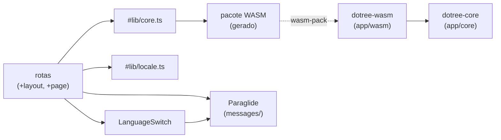

<!-- Caminho relativo: docs/architecture.md -->

# Arquitetura efetiva

> Derivada das dependências reais entre módulos (skill `mapa-de-arquitetura`). Atualizada no
> mesmo trabalho que mudar módulos ou dependências. Estado: esqueleto + `expr` (MT-3).

## Componentes

| Componente | Onde | Responsabilidade | Depende de |
|---|---|---|---|
| `dotree-core` | `app/core` | Domínio puro. Expõe `version()` e o módulo `expr`. | — |
| `dotree_core::expr` | `app/core/src/expr/` | Linguagem da expressão: lexer e analisador recursivo (`parser.rs`) que expande enquanto lê; `analyze()` valida larguras e limite de bits. Erros como códigos (IDI-05). | — |
| `dotree-wasm` | `app/wasm` | Ponte `wasm-bindgen`. Hoje exporta `coreVersion()`. | `dotree-core`, `wasm-bindgen` |
| Pacote WASM gerado | `app/web/src/lib/wasm/` (fora do git) | Saída do `wasm-pack` (`dotree.js`, `dotree_bg.wasm`). | `dotree-wasm` |
| `#lib/core.ts` | `app/web/src/lib/core.ts` | Carrega o WASM e oferece a API do núcleo à interface. | pacote WASM |
| `#lib/locale.ts` | `app/web/src/lib/locale.ts` | Idioma da primeira visita (IDI-03). | — |
| Catálogos i18n | `app/web/messages/`, gerados em `src/lib/paraglide/` | Textos pt-br e en (Paraglide). | — |
| Rotas | `app/web/src/routes/` | Layout (idioma, tokens CSS) e página inicial. | `#lib/core.ts`, `#lib/locale.ts`, Paraglide, componentes |
| Componentes | `app/web/src/lib/components/` | Hoje: `LanguageSwitch`. | Paraglide |

## Dependências

## Fronteiras que a arquitetura protege

- O núcleo não conhece navegador nem WASM (ADR 0001): `app/core/Cargo.toml` não tem
  dependência.
- A interface não tem regra de domínio: só chama `#lib/core.ts`.
- Entrega: a mesma build estática vai para o GitHub Pages (`/dotree/`) e para a imagem
  Docker (raiz) — ADR 0002.
