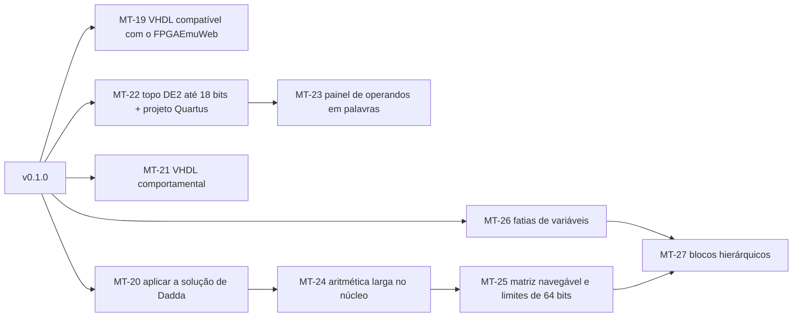
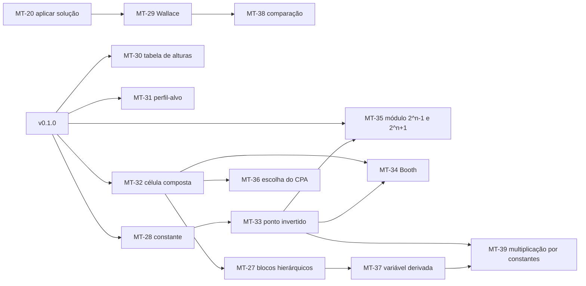

<!-- Caminho relativo: docs/plano-pos-v0.1.md -->

# Plano depois da v0.1 — laboratório de multiplicadores e conteúdo da disciplina

> **Plano, não spec.** Registra pedidos levantados ao usar o dotree num laboratório de
> multiplicadores grandes (64 × 64 numa placa DE2), com a avaliação de cada um e uma ordem
> proposta. Nada aqui muda o escopo da v0.1 sem decisão do autor; cada ticket só começa
> depois que a spec correspondente for atualizada e aprovada (`spec-como-contrato`).
> Avaliação feita em 2026-11-05 sobre o código do commit `e0bad41`. Os pedidos P9 a P20,
> sobre os capítulos 4 a 12 do livro-texto da disciplina, foram avaliados em 2026-11-06
> sobre o commit `9f07dd2`, com a sessão "CA" (ver
> [Conteúdo da disciplina](#conteúdo-da-disciplina-capítulos-4-a-12)).

## Decisões do autor (2026-11-05)

- Ordem proposta aprovada. Todos os pedidos entram no plano, inclusive os grandes.
- **MT-19** entra junto com o MT-16, antes da v0.1.0.
- **MT-20** (aplicar a solução): implementar. A adequação didática é reavaliada depois do
  uso; a spec 03 passa a permitir a substituição do circuito pela solução, contada como
  ajuda.
- **MT-22** (placa): seguir as portas que o FPGAEmuWeb já mapeia por padrão, em vez de uma
  tabela de pinos própria. Conferido no código público do emulador (lido para entender o
  comportamento; o repositório não declara licença, então nada dele é copiado):
  - a entidade de topo é lida até `end entity;` ou `end <nome>;`;
  - cada `component X is` do topo puxa o arquivo `X.vhd`;
  - portas com estes nomes ligam-se sozinhas à placa emulada: `CLOCK_50`, `CLK_500Hz`,
    `CLK_1Hz`, `CLK_10Hz`, `KEY` (4 bits), `SW` (18), `LEDR` (18), `HEX0` a `HEX7` (7 cada,
    ativos em 0);
  - os pinos reais da DE2 para o `.qsf` vêm do manual da placa, conferidos contra os
    arquivos de mapeamento do professor (que ficam fora do repositório).
- **MT-27** (blocos hierárquicos): escrever a ADR antes do código.
- A sessão "CA", que acompanha a disciplina, pode ser consultada sobre o uso no
  laboratório.

## Decisões do autor (2026-11-06)

- O professor da disciplina indicou o dotree como projeto final (nota cheia de 17/11 a
  03/12/2026) e quer usá-lo nas aulas de 2027/1. O plano de ensino pede "unidades
  aritméticas e avaliação do custo em ASIC e/ou FPGA".
- **Até o projeto final (v0.2):** MT-20, MT-21, MT-22, MT-28, MT-29, MT-30 e MT-38 (versão
  mínima); MT-31 se der tempo. Entregável: *tag* `v0.2.0`, relatório da síntese no Quartus
  (estrutural × comportamental; fica no repositório da disciplina, não aqui) e
  demonstração no FPGAEmuWeb.
- **Constante aditiva:** entra como ponto fixo em 1, comprimido como qualquer outro; o app
  não simplifica a célula que o recebe (fica como melhoria futura).
- **Depois do projeto final:** ordem por dependências, com o módulo $2^n-1$ (P16) adiantado
  para o início de 2027/1, porque o semestre começa por RNS. Marcos: $2^n-1$ no início do
  semestre; célula composta (P13) por volta da 6.ª semana; números com sinal e Booth (P14,
  P15) antes dos capítulos 9 e 10.
- **Modelo de custo** (o mesmo dos problemas do curso): FA = 1 $A_{FA}$ e 1 $T_{FA}$; HA =
  0,5 e 0,5; MUX $2^a{:}1$ = $a/2$ $A_{FA}$ e $a/2$ $T_{FA}$; portas AND contadas à parte. O
  dotree já usa o de FA e HA.
- **Multiplicação por constantes (2026-11-08):** as funções do gerador do SPIRAL (P21) entram
  reimplementadas em Rust **a partir dos artigos**, sem portar nem ler o código deles, que é
  GPL; o dotree continua MIT. O gerador online serve só como referência para os testes.
- **Comparação de soluções (P20):** aprovada.

## Os pedidos, avaliados

| # | Pedido | Situação hoje | Esforço | Specs afetadas |
|---|---|---|---|---|
| P1 | Larguras maiores: até 64 bits por variável, 128 bits de entrada, 4096 pontos; matriz navegável (zoom, rolagem); verificação por amostra | Limites de 16 bits, 32 bits e 256 pontos (`expr::MAX_WIDTH`, `MAX_INPUT_BITS`, `matrix::MAX_DOTS`). A amostra já existe acima de 24 bits. As entradas são `u64` e o valor esperado `u128`, então 64 bits por variável estoura em somas de produtos (A·B + C·D tem 129 bits) | **Grande** | 00, 01, 04, 06, 09 (desempenho) |
| P2 | Fatiar variáveis: `A[63:32]` e `A[31:0]` em vez de inventar variáveis, mantendo as portas `A` e `B` inteiras | A gramática só aceita uma letra por variável; sinais e portas saem de uma variável inteira | **Médio-grande** | 01, 05, 06 |
| P3 | Blocos hierárquicos: um subproduto ($A_H B_H$) como multiplicador instanciado, para o dividir-em-4 aparecer como 4 multiplicadores e a soma final | Fora da v0.1 ("blocos AMM como célula composta", spec 00). Netlist, diagrama e VHDL só conhecem FA, HA e AND | **Grande** | 00, 02, 05, 06 |
| P4 | VHDL comportamental (`*` e `+` de `numeric_std`) além do estrutural, para comparar recursos e caminho crítico | Fora da v0.1 (spec 06). O gerador já tem nome, larguras e testbench | **Pequeno-médio** | 06 |
| P5 | "Usar esta solução": formar as células de Dadda no exercício | O núcleo já calcula a redução de Dadda inteira (`help::dadda_solution`); a interface só mostra métricas e níveis. A spec 03 exclui a "correção automática do circuito do usuário" | **Pequeno** no código; **decisão didática** | 03 |
| P6 | Topo para a DE2 (SW, KEY, LEDR, HEX); acima de 18 bits de entrada, um painel que carrega os operandos em palavras pelas KEY e mostra o produto em fatias nos displays | Fora da v0.1 ("atribuição de pinos de placa", spec 06). Até 18 bits é só ligação; acima disso é uma máquina de estados com testbench próprio | **Médio** (≤ 18 bits) a **grande** (painel) | 06, nova spec de placa |
| P7 | Compatibilidade com o FPGAEmuWeb: `end <nome>;` em vez de `end entity <nome>;`, um arquivo por componente | Um arquivo por componente **já existe** (`full_adder.vhd`, `half_adder.vhd`, topo, testbench). Falta só a forma curta do `end`, que todo VHDL aceita e o GHDL do CI confere | **Pequeno** | 06 |
| P8 | Projeto do Quartus: `.qpf`/`.qsf` com a DE2 (EP2C35F672C6) e as atribuições de pinos | Fora da v0.1 (spec 06). Sem pinos é texto fixo; com pinos depende de P6 e de uma tabela de pinos conferida no manual da placa | **Pequeno** (sem pinos) a **médio** | 06, nova spec de placa |

### Dependências entre os pedidos

- **P1 precisa de P5 para ser usável.** Comprimir 4096 pontos à mão não é exercício; com
  matriz grande, o caminho é aplicar a solução e estudar o circuito.
- **P3 precisa de P2.** Os subprodutos são produtos de fatias ($A_H = A[63:32]$).
- **P8 precisa de P6** para as atribuições de pinos.
- P4, P5 e P7 não dependem de nada além da v0.1.

## Ordem proposta

- **Fácil e de valor imediato (v0.2):** MT-19, MT-20, MT-21. Se o autor quiser, o MT-19
  cabe antes da v0.1.0: é só a forma do `end`, conferida pelo GHDL.
- **Placa (v0.2 ou v0.3):** MT-22 e MT-23.
- **Escala do laboratório (v0.3):** MT-24 a MT-27. Exigem revisão das specs 00, 01, 05 e
  06 e provavelmente uma ADR (aritmética larga no núcleo e modelo de bloco hierárquico).

## Tickets propostos

### MT-19: VHDL compatível com o FPGAEmuWeb (P7)
- **Objetivo:** fechar entidade, arquitetura e componente na forma curta (`end <nome>;`,
  `end <arquitetura>;`, `end component;`), mantendo um arquivo por componente.
- **Arquivos no escopo:** `app/core/src/vhdl/**`, `docs/specs/06-vhdl.md`
- **Critério de aceite:** testes do núcleo sem `end entity` nem `end architecture`; job
  GHDL do CI verde; o autor confere um `.zip` no FPGAEmuWeb.
- **Decidido:** o emulador só lê o fechamento da entidade (`end entity;` ou `end <nome>;`);
  basta `end <nome>;` nas entidades. **Feito (2026-11-05)**, junto com o MT-16: GHDL com
  os mesmos vereditos do CI, e a análise de portas do emulador leu as 8 portas do R2.

### MT-20: Aplicar a solução de Dadda ao exercício (P5)
- **Objetivo:** botão "usar esta solução" depois da etapa 2 da solução, com confirmação;
  substitui o circuito do aluno pela solução, desfazível num passo, e fica no registro de
  ajudas.
- **Arquivos no escopo:** `app/wasm/src/**`, `app/web/src/**`, `docs/specs/03-ajuda-sob-demanda.md`
- **Critério de aceite:** e2e (R1 → solução aplicada → verificação "0 erros" e VHDL
  disponível; desfazer devolve o circuito do aluno).
- **Decidido:** implementar; aplicar não corrige, substitui, e conta como revelação do
  caminho. A spec 03 é ajustada no ticket.
- **Feito (2026-11-06):** AJU-09 na spec 03 e nota na spec 08. `Reduction::adopt` guarda o
  estado final da solução como um passo do histórico (desfazer devolve o circuito do aluno;
  recusa outra matriz e o circuito já igual); `Session.applySolution` exige a etapa 2 e
  conta `solutionApplied`; botão "Usar esta solução" com confirmação, fora do modo leitura.

### MT-21: VHDL comportamental (P4)
- **Objetivo:** gerar `<nome>_comportamental.vhd` com a mesma interface, usando `unsigned`,
  `*` e `+` de `numeric_std` e `resize` para W bits; o mesmo testbench serve aos dois.
- **Arquivos no escopo:** `app/core/src/vhdl/**`, `app/web/src/**`, `docs/specs/06-vhdl.md`
- **Critério de aceite:** testes do núcleo; job GHDL roda o testbench contra as duas
  arquiteturas (R2: 16 384 casos corretos em ambas).
- **Feito (2026-11-09):** VHD-10 na spec 06. Entidade própria `<nome>_comportamental` (as
  mesmas portas, um arquivo por entidade, como pede o VHD-09), para o Quartus escolher o
  topo; o testbench instancia as duas e relata cada uma. Coeficiente acima de $2^{31}-1$
  vai como cadeia de bits. GHDL e ModelSim: R2 correto nas duas; o comportamental
  estragado de propósito falha só nele.

### MT-22: Topo para a DE2 até 18 bits e projeto do Quartus (P6, P8)
- **Objetivo:** com até 18 bits de entrada, gerar um topo que liga as entradas às chaves
  `SW`, o resultado a `LEDR` e `HEX` (hexadecimal); exportar `.qpf`/`.qsf` para a
  EP2C35F672C6 com as atribuições de pinos.
- **Arquivos no escopo:** `app/core/src/vhdl/**` (ou módulo novo `board`), `app/web/src/**`,
  nova spec de placa
- **Critério de aceite:** testes do núcleo; tabela de pinos conferida contra o manual da
  DE2, com referência à fonte e sem copiar o documento; GHDL compila o topo.
- **Decidido:** portas com os nomes padrão do FPGAEmuWeb (`SW`, `KEY`, `LEDR`, `HEX0`–`HEX7`),
  que ele liga sem mapeamento manual. Spec nova, `10-placa.md`.
- **Feito (2026-11-09):** spec 10 (PLA-01 a PLA-07). Módulo `board` (limites, pinos,
  segmentos); topo `<nome>_de2`, `tb_<nome>_de2`, `.qpf` e `.qsf` quando há até 18 bits de
  entrada e $W \le 32$. Pinos conferidos contra duas cópias do arquivo de pinos da DE2;
  Quartus II 13.0 compilou o projeto do R2 com os pinos certos; GHDL e ModelSim conferiram o
  testbench da placa e pegaram o topo estragado de propósito.

### MT-23: Painel de operandos em palavras (P6)
- **Objetivo:** acima de 18 bits de entrada, uma máquina de estados que carrega cada
  operando em palavras pelas `KEY` e mostra o resultado em fatias nos displays.
- **Critério de aceite:** testbench próprio do painel no job GHDL.
- **Depende de:** MT-22

### MT-24: Aritmética larga no núcleo (P1, parte 1)
- **Objetivo:** entradas e valores acima de 64 e 128 bits (inteiro largo próprio ou crate),
  sem perder a simulação bit-paralela.
- **Decisão pendente:** ADR sobre o tipo de inteiro largo.
- **Depende de:** MT-20 (sem aplicar a solução, a escala não é praticável)

### MT-25: Limites de 64 bits e matriz navegável (P1, parte 2)
- **Objetivo:** 64 bits por variável, 128 de entrada, 4096 pontos; matriz com zoom e
  rolagem; desempenho medido com 4096 pontos.
- **Depende de:** MT-24

### MT-26: Fatias de variáveis (P2)
- **Objetivo:** `A[63:32]` na expressão, com a largura da variável inteira declarada uma
  vez; sinais e portas mantêm `A` inteira.
- **Decisão pendente:** sintaxe (`A[63:32]` ou `A_H` declarado como fatia) e o que a
  matriz mostra.

### MT-27: Blocos hierárquicos (P3)
- **Objetivo:** subprodutos como blocos multiplicadores instanciados (netlist, diagrama,
  VHDL), cada um com o próprio exercício ou a solução automática.
- **Decisão pendente:** modelo do bloco e se o aluno comprime cada bloco ou só a soma
  final. Precisa de ADR.
- **Depende de:** MT-25, MT-26

## Conteúdo da disciplina (capítulos 4 a 12)

Referência: B. Parhami, *Computer Arithmetic*, 2.ª ed., caps. 4 a 12. Os problemas e
laboratórios da disciplina são material de terceiros: citados pelo número, nunca copiados.

### O que a v0.1 já cobre

- **8.3, quase todo:** um contador generalizado é uma matriz de bits independentes
  ({2,2,3; …} = `A+B+C+2D+2E+4F+4G`, larguras 1). Falta parar num perfil de saída (P12).
- **8.1 sem a constante** (F1 com 48 pontos, F2 com 56), **9.4 em parte** (978943·A até
  14 bits de A) e o **AMM** $A \times B + C \times D + 2(E+F) + G$.

### Os pedidos

| # | Pedido (capítulo) | Situação hoje | Esforço | Specs |
|---|---|---|---|---|
| P9 | Constante aditiva: `+36`, `+8`, `+1164` (8.1, lab do cap. 8, cap. 5) | O parser já a representa como monômio sem variáveis e a recusa de propósito (`ConstantTerm`, EXP-13); um sinal sem fatores já vale 1 | **Pequeno-médio** | 00, 01, 05, 06 |
| P10 | Solução de Wallace ao lado da de Dadda (8.3) | Só Dadda (`help::dadda_solution`) | **Pequeno-médio** | 03 |
| P11 | Tabela de alturas nível a nível (8.2) | As alturas aparecem por painel, não numa tabela | **Pequeno** | 02 |
| P12 | Entrada por alturas com perfil-alvo de saída: `{2,2,3; 1,1,1,1}`, `{3,3,3; 1,2,2,1}` (8.3) | A redução sempre para em 2 linhas + CPA. Na notação do professor, depois do ";" vêm as alturas de saída por coluna | **Pequeno** | 01, 02 |
| P13 | Célula composta: contador 7:3, (5,5;4), compressor 4:2, AMM 2×2 (8.4, 12.1, 12.2) e multiplicador hierárquico (P3) | A célula é só `CellKind::{Fa, Ha}`, com duas saídas; um 7:3 tem 3 saídas em 3 colunas | **Grande** | 00, 02, 05, 06, 08 |
| P14 | Ponto invertido: Baugh-Wooley e recodificação com dígito −1 (9.4, 9.5) | Sem sinal e sem NOT | **Médio-grande** | 00, 01, 04, 06 |
| P15 | Booth radix-2 e radix-4, com mux e múltiplos (9.4, cap. 10) | Sem sinal selecionado por mux | **Grande** | 00, 01, 02, 06 |
| P16 | Matriz módulo $2^n-1$ e depois $2^n+1$ (8.5, cap. 4, labs de RNS) | Sem volta de colunas. A árvore com volta não fecha laço; o CPA modular segue o padrão de dois somadores e um MUX 2:1, sem laço. $2^n+1$ pede P14 | **Médio** ($2^n-1$) a **grande** | 01, 02, 04, 06 |
| P17 | Escolha do CPA final: CLA, prefixo, *carry-select* (caps. 6 e 7) | Só *ripple* | **Médio-grande** | 00, 02, 05, 06 |
| P18 | Variável derivada: múltiplos pré-computados ($7A$) e constante grande (9.4, 9.5) | Literal até $2^{32}$ (EXP-14), 256 pontos | **Grande** | 01, 02 |
| P19 | Animação de *shift-add*, à esquerda e à direita (9.1) | Fora do modelo combinacional | **Médio** | nova |
| P20 | Comparação visual de soluções do mesmo problema | Métricas de uma solução por vez | **Pequeno-médio** (mínima) | 02, 03 |
| P21 | Bloco multiplicador por constantes (MCM), como o gerador do SPIRAL: Hcub com limite de profundidade (9.4, 9.5) | Constante só expandida em pontos; sem subtração nem múltiplo pré-computado | **Médio** | 01, 02, 06, nova |

### Dependências

- P12 fecha o 8.3 inteiro **sem** célula composta; P13 só é preciso para **usar** esses
  blocos como células (8.4).
- P13 serve ao P3 (MT-27), ao P15 e ao P17.
- P14 precisa de P9 (a correção de sinal é constante); P15 precisa de P14 e de P13.
- P16 com $2^n+1$ precisa de P14 (volta invertida).
- P18 precisa de P1 (MT-24) e de P3 (MT-27).
- P20 fica completo com P10 (Wallace).
- P21 precisa de P14 (o Hcub subtrai) e de P18 (os múltiplos viram variáveis derivadas).

## Tickets propostos (P9 a P21)

### MT-28: Constante aditiva (P9)
- **Objetivo:** aceitar termos constantes (`+36`, `3(A+1)`), combinados num só; seus bits em 1
  viram pontos fixos com cor própria, que o aluno comprime como os outros; VHDL com `'1'`.
- **Arquivos no escopo:** `app/core/src/{expr,matrix,netlist,vhdl,diagram}/**`,
  `app/web/src/**`, specs 00, 01, 05 e 06
- **Critério de aceite:** testes do núcleo; e2e com o lab do cap. 8 (44 pontos e a
  constante, $W$ = 13); GHDL verde com a constante.
- **Feito (2026-11-09):** EXP-13 refeito (só recusa expressão sem variável) e EXP-15 novo.
  O sinal sem fatores, que a matriz já gerava como AND vazio, ganhou o nome `one`, `'1'` no
  VHDL e o rótulo 1 na tela. O e2e usa uma expressão própria, `3(A + 1) + B` (os exemplos
  do projeto não reproduzem enunciados de terceiros); o lab do cap. 8 foi conferido só
  localmente: 46 pontos (44 + 2 fixos) e $W = 14$ com $A$ a $D$ de 4 bits ($v_{max} =
  11916$), não 13 como anotado acima.

### MT-29: Solução de Wallace (P10)
- **Objetivo:** `help::wallace_solution` (em cada nível, o máximo de FA e depois HA), com o
  mesmo fluxo de revelação e aplicação do MT-20.
- **Critério de aceite:** testes do núcleo com R1 e R2 conferidos à mão; e2e de aplicar.
- **Depende de:** MT-20

### MT-30: Tabela de alturas nível a nível (P11)
- **Objetivo:** tabela com a altura de cada coluna em cada nível, exportável em Markdown.
- **Critério de aceite:** teste com as alturas do R2 (spec 05).

### MT-31: Entrada por alturas com perfil-alvo de saída (P12)
- **Objetivo:** aceitar `{2,2,3; 1,1,1,1}` (alturas de entrada e de saída, do bit mais
  significativo ao menos), parar quando o perfil de saída for atingido e mostrar área e
  atraso do bloco; o nome do bloco conhecido aparece só como revelação opcional.
- **Critério de aceite:** a solução ótima reproduz as áreas e atrasos dos 11 itens do
  gabarito do problema 8.3, citados pela fonte, sem copiar o documento.

### MT-32: Célula composta (P13)
- **Objetivo:** modelo de célula com entradas e saídas em várias colunas, custo e atraso
  vindos da rede interna; contadores, compressor 4:2 e AMM 2×2 como os primeiros tipos.
- **Decisão pendente:** ADR 0004 (modelo de célula composta), que vale também para o MT-27.

### MT-33: Ponto invertido e números com sinal (P14)
- **Objetivo:** pontos negados e a constante de correção; Baugh-Wooley e recodificação com
  dígito −1 para constantes.
- **Depende de:** MT-28

### MT-34: Booth radix-2 e radix-4 (P15)
- **Depende de:** MT-32, MT-33

### MT-35: Matriz módulo $2^n-1$ e $2^n+1$ (P16)
- **Objetivo:** pesos com volta direta ($2^n-1$) e invertida ($2^n+1$); CPA modular com dois
  somadores e MUX 2:1. Começa por $2^n-1$, para o início de 2027/1.
- **Depende de:** MT-33 (só a parte $2^n+1$)

### MT-36: Escolha do CPA final (P17)
- **Objetivo:** *ripple*, *carry-select* e prefixo, com o modelo de custo do MUX.
- **Depende de:** MT-32

### MT-37: Variável derivada e constante grande (P18)
- **Depende de:** MT-24, MT-27

### MT-38: Comparação de soluções (P20)
- **Objetivo:** guardar soluções do mesmo problema (aluno, Dadda, Wallace, versões salvas)
  e compará-las lado a lado: área, atraso, FA, HA, AND, níveis, largura do CPA, caminhos
  críticos, área × atraso e área × atraso²; gráfico área × atraso com a fronteira das
  soluções não dominadas. Depois: perfis de alturas sobrepostos e números da síntese no
  Quartus.
- **Critério de aceite:** e2e com R1 (aluno × Dadda × Wallace) e os números conferidos
  contra as métricas de cada solução.
- **Depende de:** MT-29

### MT-39: Multiplicação por constantes, MCM (P21)
- **Objetivo:** dado $Y = c_1 A$ (ou várias constantes sobre a mesma variável), calcular o
  grafo de somadores do Hcub, com limite de profundidade opcional, e usar os múltiplos
  como variáveis derivadas; o aluno compara, no MT-38, a constante expandida em pontos (CSD)
  com os múltiplos pré-computados mais a árvore.
- **Fonte:** Y. Voronenko e M. Püschel, "Multiplierless multiple constant multiplication",
  *ACM Transactions on Algorithms*, 2007. Implementação a partir do artigo, sem consultar o
  código GPL do SPIRAL; RAG-n fica de fora (precisa da tabela pré-calculada deles) e o BHM
  fica para depois.
- **Critério de aceite:** número de somadores e profundidade iguais aos do gerador online
  num conjunto de casos anotados (só os números, com data e opções usadas); grafo e VHDL
  conferidos pelo GHDL.
- **Depende de:** MT-33, MT-37

A animação de *shift-add* (P19) fica sem ticket até haver espaço depois da v0.4.
