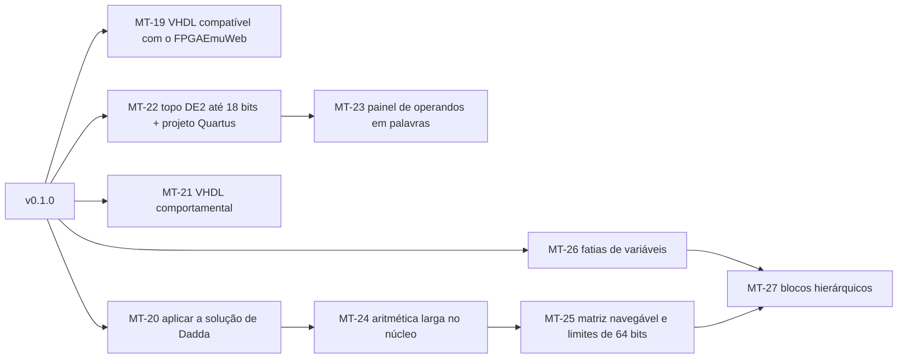

<!-- Caminho relativo: docs/plano-pos-v0.1.md -->

# Plano depois da v0.1 — pedidos do laboratório de multiplicadores

> **Plano, não spec.** Registra pedidos levantados ao usar o dotree num laboratório de
> multiplicadores grandes (64 × 64 numa placa DE2), com a avaliação de cada um e uma ordem
> proposta. Nada aqui muda o escopo da v0.1 sem decisão do autor; cada ticket só começa
> depois que a spec correspondente for atualizada e aprovada (`spec-como-contrato`).
> Avaliação feita em 2026-11-05 sobre o código do commit `e0bad41`.

## Os pedidos, avaliados

| # | Pedido | Situação hoje | Esforço | Specs afetadas |
|---|---|---|---|---|
| P1 | Larguras maiores: até 64 bits por variável, 128 bits de entrada, 4096 pontos; matriz navegável (zoom, rolagem); verificação por amostra | Limites de 16 bits, 32 bits e 256 pontos (`expr::MAX_WIDTH`, `MAX_INPUT_BITS`, `matrix::MAX_DOTS`). A amostra já existe acima de 24 bits. As entradas são `u64` e o valor esperado `u128`, então 64 bits por variável estoura em somas de produtos (A·B + C·D tem 129 bits) | **Grande** | 00, 01, 04, 06, 09 (desempenho) |
| P2 | Fatiar variáveis: `A[63:32]` e `A[31:0]` em vez de inventar variáveis, mantendo as portas `A` e `B` inteiras | A gramática só aceita uma letra por variável; sinais e portas saem de uma variável inteira | **Médio-grande** | 01, 05, 06 |
| P3 | Blocos hierárquicos: um subproduto ($A_H B_H$) como multiplicador instanciado, para o dividir-em-4 aparecer como 4 multiplicadores e a soma final | Fora da v0.1 ("blocos AMM como célula composta", spec 00). Netlist, diagrama e VHDL só conhecem FA, HA e AND | **Grande** | 00, 02, 05, 06 |
| P4 | VHDL comportamental (`*` e `+` de `numeric_std`) além do estrutural, para comparar recursos e caminho crítico | Fora da v0.1 (spec 06). O gerador já tem nome, larguras e testbench | **Pequeno-médio** | 06 |
| P5 | "Usar esta solução": formar as células de Dadda no exercício | O núcleo já calcula a redução de Dadda inteira (`help::dadda_solution`); a interface só mostra métricas e níveis. A spec 03 exclui a "correção automática do circuito do usuário" | **Pequeno** no código; **decisão didática** | 03 |
| P6 | Topo para a DE2 (SW, KEY, LEDR, HEX); acima de 18 bits de entrada, um painel que carrega os operandos em palavras pelas KEY e mostra o produto em fatias nos displays | Fora da v0.1 ("atribuição de pinos de placa", spec 06). Até 18 bits é só ligação; acima disso é uma máquina de estados com testbench próprio | **Médio** (≤ 18 bits) a **grande** (painel) | 06, nova spec de placa |
| P7 | Compatibilidade com o FPGAEmuWeb: `end <nome>;` em vez de `end entity <nome>;`, um arquivo por componente | Um arquivo por componente **já existe** (`full_adder.vhd`, `half_adder.vhd`, topo, testbench). Falta só a forma curta do `end`, que todo VHDL aceita e o GHDL do CI confere | **Pequeno** | 06 |
| P8 | Projeto do Quartus: `.qpf`/`.qsf` com a DE2 (EP2C35F672C6) e as atribuições de pinos | Fora da v0.1 (spec 06). Sem pinos é texto fixo; com pinos depende de P6 e de uma tabela de pinos conferida no manual da placa | **Pequeno** (sem pinos) a **médio** | 06, nova spec de placa |

### Dependências entre os pedidos

- **P1 precisa de P5 para ser usável.** Comprimir 4096 pontos à mão não é exercício; com
  matriz grande, o caminho é aplicar a solução e estudar o circuito.
- **P3 precisa de P2.** Os subprodutos são produtos de fatias ($A_H = A[63:32]$).
- **P8 precisa de P6** para as atribuições de pinos.
- P4, P5 e P7 não dependem de nada além da v0.1.

## Ordem proposta

- **Fácil e de valor imediato (v0.2):** MT-19, MT-20, MT-21. Se o autor quiser, o MT-19
  cabe antes da v0.1.0: é só a forma do `end`, conferida pelo GHDL.
- **Placa (v0.2 ou v0.3):** MT-22 e MT-23.
- **Escala do laboratório (v0.3):** MT-24 a MT-27. Exigem revisão das specs 00, 01, 05 e
  06 e provavelmente uma ADR (aritmética larga no núcleo e modelo de bloco hierárquico).

## Tickets propostos

### MT-19: VHDL compatível com o FPGAEmuWeb (P7)
- **Objetivo:** fechar entidade, arquitetura e componente na forma curta (`end <nome>;`,
  `end <arquitetura>;`, `end component;`), mantendo um arquivo por componente.
- **Arquivos no escopo:** `app/core/src/vhdl/**`, `docs/specs/06-vhdl.md`
- **Critério de aceite:** testes do núcleo sem `end entity` nem `end architecture`; job
  GHDL do CI verde; o autor confere um `.zip` no FPGAEmuWeb.
- **Decisão pendente:** quais formas o emulador recusa além de `end entity` (o autor testa
  um arquivo antes).

### MT-20: Aplicar a solução de Dadda ao exercício (P5)
- **Objetivo:** botão "usar esta solução" depois da etapa 2 da solução, com confirmação;
  substitui o circuito do aluno pela solução, desfazível num passo, e fica no registro de
  ajudas.
- **Arquivos no escopo:** `app/wasm/src/**`, `app/web/src/**`, `docs/specs/03-ajuda-sob-demanda.md`
- **Critério de aceite:** e2e (R1 → solução aplicada → verificação "0 erros" e VHDL
  disponível; desfazer devolve o circuito do aluno).
- **Decisão pendente:** como conciliar com "correção automática fora de escopo" (spec 03).
  Proposta: aplicar não corrige, substitui, e conta como revelação do caminho.

### MT-21: VHDL comportamental (P4)
- **Objetivo:** gerar `<nome>_comportamental.vhd` com a mesma interface, usando `unsigned`,
  `*` e `+` de `numeric_std` e `resize` para W bits; o mesmo testbench serve aos dois.
- **Arquivos no escopo:** `app/core/src/vhdl/**`, `app/web/src/**`, `docs/specs/06-vhdl.md`
- **Critério de aceite:** testes do núcleo; job GHDL roda o testbench contra as duas
  arquiteturas (R2: 16 384 casos corretos em ambas).

### MT-22: Topo para a DE2 até 18 bits e projeto do Quartus (P6, P8)
- **Objetivo:** com até 18 bits de entrada, gerar um topo que liga as entradas às chaves
  `SW`, o resultado a `LEDR` e `HEX` (hexadecimal); exportar `.qpf`/`.qsf` para a
  EP2C35F672C6 com as atribuições de pinos.
- **Arquivos no escopo:** `app/core/src/vhdl/**` (ou módulo novo `board`), `app/web/src/**`,
  nova spec de placa
- **Critério de aceite:** testes do núcleo; tabela de pinos conferida contra o manual da
  DE2, com referência à fonte e sem copiar o documento; GHDL compila o topo.
- **Decisão pendente:** abrir uma spec nova (`10-placa.md`) ou ampliar a spec 06.

### MT-23: Painel de operandos em palavras (P6)
- **Objetivo:** acima de 18 bits de entrada, uma máquina de estados que carrega cada
  operando em palavras pelas `KEY` e mostra o resultado em fatias nos displays.
- **Critério de aceite:** testbench próprio do painel no job GHDL.
- **Depende de:** MT-22

### MT-24: Aritmética larga no núcleo (P1, parte 1)
- **Objetivo:** entradas e valores acima de 64 e 128 bits (inteiro largo próprio ou crate),
  sem perder a simulação bit-paralela.
- **Decisão pendente:** ADR sobre o tipo de inteiro largo.
- **Depende de:** MT-20 (sem aplicar a solução, a escala não é praticável)

### MT-25: Limites de 64 bits e matriz navegável (P1, parte 2)
- **Objetivo:** 64 bits por variável, 128 de entrada, 4096 pontos; matriz com zoom e
  rolagem; desempenho medido com 4096 pontos.
- **Depende de:** MT-24

### MT-26: Fatias de variáveis (P2)
- **Objetivo:** `A[63:32]` na expressão, com a largura da variável inteira declarada uma
  vez; sinais e portas mantêm `A` inteira.
- **Decisão pendente:** sintaxe (`A[63:32]` ou `A_H` declarado como fatia) e o que a
  matriz mostra.

### MT-27: Blocos hierárquicos (P3)
- **Objetivo:** subprodutos como blocos multiplicadores instanciados (netlist, diagrama,
  VHDL), cada um com o próprio exercício ou a solução automática.
- **Decisão pendente:** modelo do bloco e se o aluno comprime cada bloco ou só a soma
  final. Precisa de ADR.
- **Depende de:** MT-25, MT-26
