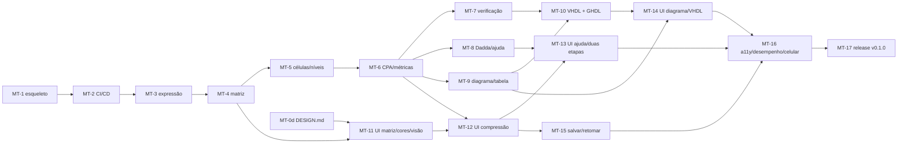

<!-- Caminho relativo: docs/plano.md -->

# Plano da v0.1

> **Plano, não spec**: fixa a sequência e é descartável. O resultado esperado está em
> [`docs/specs/`](specs/README.md); o painel de uma linha por ticket, em
> [`TICKETS.md`](TICKETS.md). Cada ticket cabe num ciclo de contexto do agente, começa por um
> teste que falha (`teste-primeiro`) e termina com o comando de aceite rodando.

## Ordem e dependências

Os tickets do núcleo (MT-3 a MT-10) não dependem da interface e podem andar na frente. A
interface só começa a consumir uma API do núcleo depois que ela tem teste.

---

### MT-0: Ler e aprovar a spec revisada
- **Objetivo:** o autor lê `docs/specs/` e aprova, ou pede mudanças.
- **Arquivos no escopo:** `docs/specs/*`
- **Critério de aceite:** `docs/specs/README.md` com estado "aprovada" e data.
- **Fora de escopo:** código.
- **Depende de:** nenhum

### MT-0d: Escrever o contrato visual (`docs/DESIGN.md`)
- **Objetivo:** fixar paleta dos termos (8 cores, claro/escuro, COR-03), cor de resultado,
  preto dos pontos gerados, tipografia, espaçamento e o desenho de ponto, célula e painel de
  nível, no estilo das figuras de aula.
- **Arquivos no escopo:** `docs/DESIGN.md`, `app/web/src/app.css`
- **Critério de aceite:** teste de unidade da paleta (contraste ≥ 3:1 nos dois temas) passa
  em `pnpm --dir app/web run test`.
- **Fora de escopo:** componentes.
- **Depende de:** MT-0

### MT-1: Criar o esqueleto do código
- **Objetivo:** workspace Rust (`dotree-core`, `dotree-wasm`), SvelteKit estático com
  Paraglide, Vitest e Playwright, página que carrega o WASM e mostra a versão.
- **Arquivos no escopo:** `Cargo.toml`, `rust-toolchain.toml`, `app/**`
- **Critério de aceite:** `cargo test`; `pnpm --dir app/web run check`, `lint`, `test`;
  `BASE_PATH=/dotree pnpm --dir app/web run build && … run test:e2e` (ENT-03, IDI-02,
  IDI-03, IDI-04, GER-09 parcial).
- **Fora de escopo:** qualquer regra de domínio.
- **Depende de:** ADR-0001

### MT-2: Montar CI/CD, Pages e imagem Docker
- **Objetivo:** `ci.yml` (Rust, interface, Docker, segredos, Pages), `release.yml`,
  Dependabot, `Dockerfile`.
- **Arquivos no escopo:** `.github/**`, `Dockerfile`, `.dockerignore`
- **Critério de aceite:** `docker build -t dotree .` e fumaça local; no GitHub, o CI verde em
  `main` e o site no ar em `https://psiagoleal.github.io/dotree/` (ENT-01 a ENT-04, ENT-07,
  ENT-08). ENT-05 é conferido na primeira *tag*.
- **Fora de escopo:** job de GHDL (MT-10).
- **Depende de:** MT-1, ADR-0002

### MT-18: Proteger o repositório público
- **Objetivo:** `main` só por PR com `CI ok` verde, só o dono mescla, tags `v*` só por admin,
  aprovação de workflow de fork, alertas e correções do Dependabot, relato privado.
- **Arquivos no escopo:** `.github/governanca/**`, `.github/workflows/ci.yml` (job `CI ok`),
  `.github/SECURITY.md`, `.github/pull_request_template.md`, `docs/adr/0003-*`
- **Critério de aceite:** `.github/governanca/aplicar.sh --conferir` termina com 0 falhas, e
  um PR de teste mostra o merge bloqueado até o `CI ok` ficar verde.
- **Fora de escopo:** CODEOWNERS e aprovação obrigatória (ver ADR 0003).
- **Depende de:** MT-2, ADR-0003

### MT-3: Analisar a expressão
- **Objetivo:** do texto à soma de monômios expandida, combinada e com coeficientes; erros
  com posição.
- **Arquivos no escopo:** `app/core/src/expr/**`
- **Critério de aceite:** `cargo test -p dotree-core --test expr` cobrindo EXP-05, EXP-06,
  EXP-07, EXP-08 (limite de bits), EXP-11, EXP-13, EXP-14 e os casos de expansão de EXP-01.
- **Fora de escopo:** geração de pontos.
- **Depende de:** MT-1

### MT-4: Gerar a matriz de pontos
- **Objetivo:** decomposição binária, pontos, sinais compartilhados, ANDs, $v_{max}$, $W$,
  termo de origem de cada ponto (para a cor).
- **Arquivos no escopo:** `app/core/src/matrix/**`
- **Critério de aceite:** `cargo test -p dotree-core --test matrix` com R1, R3, R4 (EXP-01 a
  EXP-03, EXP-08 em pontos, base de COR-01).
- **Fora de escopo:** células.
- **Depende de:** MT-3

### MT-5: Formar células e níveis
- **Objetivo:** FA/HA, prontidão, recusas, concluir nível, numeração, ordem canônica,
  desfazer e refazer, voltar de nível, vai-um descartado.
- **Arquivos no escopo:** `app/core/src/reduce/**`
- **Critério de aceite:** `cargo test -p dotree-core reduce` (CMP-01 a CMP-04, CMP-06 a
  CMP-09, CMP-16; 1000 operações de CMP-03).
- **Fora de escopo:** CPA.
- **Depende de:** MT-4

### MT-6: Fechar com CPA e calcular métricas
- **Objetivo:** habilitação do CPA, *ripple* com FA/HA/fio, resultado $R_j$, área, atraso,
  caminhos críticos; reprodução de R2 célula a célula.
- **Arquivos no escopo:** `app/core/src/reduce/**`, `app/core/tests/r2.rs`
- **Critério de aceite:** `cargo test -p dotree-core` com R2 → 13 FA, 4 HA, 15 $A_{FA}$,
  6 $T_{FA}$ (CMP-10 a CMP-15, GER-04).
- **Fora de escopo:** verificação por simulação.
- **Depende de:** MT-5

### MT-7: Verificar o circuito
- **Objetivo:** simulação célula a célula, amostra xorshift64\*, contraexemplo, progresso e
  cancelamento pela API.
- **Arquivos no escopo:** `app/core/src/verify/**`
- **Critério de aceite:** `cargo test -p dotree-core verify` (VER-01 a VER-03, VER-06 com
  proptest).
- **Fora de escopo:** interface de progresso (MT-14).
- **Depende de:** MT-6

### MT-8: Solução Dadda, próxima jogada, dicas e limite inferior
- **Objetivo:** algoritmo de Dadda a partir do nível 0 e do estado atual, catálogo de
  dicas, limite inferior.
- **Arquivos no escopo:** `app/core/src/help/**`
- **Critério de aceite:** `cargo test -p dotree-core help` (AJU-04 a AJU-06, AJU-08).
- **Fora de escopo:** confirmação e duas etapas (interface, MT-13).
- **Depende de:** MT-6

### MT-9: Leiaute do diagrama e tabela de ligações
- **Objetivo:** posições (linha, coluna, ordem), ligações rotuladas, tabela de ligações,
  conjunto de células críticas.
- **Arquivos no escopo:** `app/core/src/diagram/**`
- **Critério de aceite:** `cargo test -p dotree-core diagram` com a tabela de referência de R2
  (DIA-01, DIA-03, DIA-04, DIA-05).
- **Fora de escopo:** SVG (MT-14).
- **Depende de:** MT-6

### MT-10: Gerar VHDL e verificá-lo com GHDL no CI
- **Objetivo:** `full_adder`, `half_adder`, topo, testbench; job `vhdl` no CI.
- **Arquivos no escopo:** `app/core/src/vhdl/**`, `.github/workflows/ci.yml`
- **Critério de aceite:** `cargo test -p dotree-core vhdl`; GHDL em contêiner analisa e
  simula R2 com "16384 CASOS CORRETOS" e acusa o circuito corrompido (VHD-01 a VHD-04,
  VHD-06, ENT-06).
- **Fora de escopo:** download e zip (MT-14).
- **Depende de:** MT-7, MT-9

### MT-11: Interface — expressão, matriz, cores e visão indexada
- **Objetivo:** entrada da expressão e larguras, exemplos, matriz colorida por termo,
  legenda, alternância pontos ↔ variáveis indexadas, desafio de $W$.
- **Arquivos no escopo:** `app/web/src/**`, `app/web/messages/*`, `app/wasm/src/**`
- **Critério de aceite:** `pnpm --dir app/web run test` e `test:e2e` (EXP-04, EXP-09 a EXP-12,
  COR-01 a COR-03, VIS-01 a VIS-04).
- **Fora de escopo:** compressão.
- **Depende de:** MT-4, MT-0d

### MT-12: Interface — compressão
- **Objetivo:** seleção por mouse e teclado, formar célula, recusas, painéis por nível,
  concluir nível, desfazer, CPA, métricas, caminho crítico.
- **Arquivos no escopo:** `app/web/src/**`, `app/wasm/src/**`
- **Critério de aceite:** e2e completando R2 pela interface com as métricas certas (CMP-05,
  CMP-13 a CMP-15, GER-02, GER-07 parcial).
- **Fora de escopo:** ajuda.
- **Depende de:** MT-6, MT-11

### MT-13: Interface — ajuda sob demanda em duas etapas
- **Objetivo:** degraus de ajuda com confirmação, revelação resultado → caminho, painel da
  solução Dadda, registro de ajudas no resumo.
- **Arquivos no escopo:** `app/web/src/**`
- **Critério de aceite:** e2e `ajuda-nao-aparece-sem-pedido` e um teste por linha da tabela
  de GER-03 (GER-01, GER-03, AJU-01 a AJU-04, AJU-07).
- **Fora de escopo:** novos tipos de dica.
- **Depende de:** MT-8, MT-12

### MT-14: Interface — diagrama, tabela, verificação e VHDL
- **Objetivo:** diagrama SVG, tabela de ligações, exportações SVG e Markdown, verificação
  com progresso e cancelamento, VHDL com cópia e `.zip`.
- **Arquivos no escopo:** `app/web/src/**`
- **Critério de aceite:** e2e (DIA-02, DIA-06, DIA-07, VER-04, VER-05, VHD-05, VHD-07).
- **Fora de escopo:** edição do diagrama.
- **Depende de:** MT-9, MT-10, MT-12

### MT-15: Salvar, abrir e retomar
- **Objetivo:** autosave local, exportar e importar JSON, estado corrompido.
- **Arquivos no escopo:** `app/core/src/state/**`, `app/web/src/**`
- **Critério de aceite:** `cargo test -p dotree-core state` e e2e (SAL-01 a SAL-05).
- **Fora de escopo:** link compartilhável (D-6).
- **Depende de:** MT-12

### MT-16: Acessibilidade, desempenho e tela pequena
- **Objetivo:** axe sem violações graves, R2 só por teclado, 100 ms no p95, modo leitura
  abaixo de 768 px, sem rede após carregar, sem requisições externas.
- **Arquivos no escopo:** `app/web/**`
- **Critério de aceite:** e2e (GER-05 a GER-08, GER-10).
- **Fora de escopo:** compressão por toque.
- **Depende de:** MT-13, MT-14, MT-15

### MT-17: Publicar a v0.1.0
- **Objetivo:** CHANGELOG da versão, conferência manual do VHDL no ModelSim, *tag* `v0.1.0`.
- **Arquivos no escopo:** `CHANGELOG.md`, `README.md`
- **Critério de aceite:** release do GitHub e imagem no GHCR (ENT-05); site no ar com a
  versão.
- **Fora de escopo:** Wallace, CSV, link compartilhável (v0.2).
- **Depende de:** MT-16
